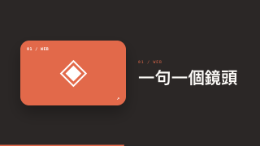
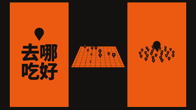

# make-demo-video

[繁體中文](/README.md) | English

A Claude Code skill + mod: turn your material into a demo video (MP4 + GIF) in minutes.

- **Skill**: `/make-demo-video` reads the material, writes a script, lays out a storyboard, then renders it frame by frame in a browser and joins the frames with ffmpeg.
- **Mod**: a progress pane next to the chat. Pick a cut, see a thumbnail of every scene, adjust the storyboard, and press 合成影片 (Render) when it looks right.


This showreel was made with the skill's own signature cut; its script, beat sheet and source are in [examples/showreel/](examples/showreel/), and the version with music is [demo.mp4](examples/showreel/demo.mp4). For what a run looks like in the VS Code pane, see [examples/skill-flow/skill-flow.gif](examples/skill-flow/skill-flow.gif).

### How it works

| Step | What happens | Output |
|---|---|---|
| ① Cut | Claude reads the text, documents or URL and recommends a cut with a reason; pick the cut, aspect, length and scene count in the pane; colours always come from the material | `style.json` |
| ② Script | Claude writes the script for the chosen cut (one line per scene) | `script.md` |
| ③ Storyboard | Move, delete, reword or redo single scenes on the board | `storyboard.json` |
| ④ Render | Render once you confirm | `demo.mp4`, `demo.gif`, result page |

The video is computed from the storyboard, not recorded: change a caption and it re-renders in about 20 seconds; don't like a scene? Have Claude redo just that scene, or pick a different cut in the pane.

### Three cuts

A cut decides how the video is edited (script shape, shot order, pacing). Cuts live in `skills/make-demo-video/cuts/`, one folder each. In step ① Claude recommends 1–3 of them for your material, with a reason for the first.

| | Fast tour `fast-tour` | Signature `signature` | Walkthrough `walkthrough` (experimental) |
|---|---|---|---|
| |  |  |  |
| Answers | **What** the product has | **Who** it is | **How** to use it |
| Looks like | A tagline opener, a phone scrolling the site to the proof for each line, quick-cut cards; counting numbers and question cuts when the material has them | One concept from start to finish, every frame morphing out of the previous one with no hard cuts; music, motion blur, and a last frame that loops back to the first | The web page fills the frame and one camera follows the cursor: result first, find it, click, zoom into the detail, end on the URL; a single hard cut on the music's downbeat |
| Good for | Products and portfolios with a site to screenshot; README GIFs | Launches, talk openers, brand reels for social | Sites or tools with a clear flow (search, switch, one-click copy) |
| Material | A website (full-page mobile screenshots) | Product name, tagline, questions users ask; screenshots optional | A website (desktop, one screenshot per step of the flow) |
| Defaults | 16:9, 15 s, 0.4 s per beat | 9:16, 15 s, 0.5 s per beat | 16:9 only, 22 s, 0.5 s per beat |
| How it's built | Combines fixed shot templates | Generative: pick a concept in the pane, and Claude writes a fresh `reel.html` each time | Combines fixed shot templates |

Fast tour and walkthrough only combine fixed shot templates, so the same storyboard always renders the same video.

Walkthrough is experimental and frozen for now: it only renders 16:9, and the pane doesn't offer 9:16. It always has 8 segments, and the pane can't add or remove script lines yet; to show one more step (up to 5), add a line to `script.md` and ask Claude in the chat to re-plan from the script.

 Signature gives a different concept and look every run, and takes about 10 minutes and 100,000-plus tokens from reading the material to the finished video; once it's final, caption changes and re-renders edit the same `reel.html`, and each beat-level edit takes 1–3 minutes.

### Install

```bash
claude plugin marketplace add muchuanhung/make-demo-video
claude plugin install make-demo-video@make-demo-video --scope user
```

Sessions started after the install load it. Needs Node 18 or later and Google Chrome; ffmpeg ships with the package.

### Use

```text
/make-demo-video turn this repo into a demo video for the README
/make-demo-video https://example.com make a 20-second vertical intro video
```

The pane shows thumbnails in the VS Code Claude chat panel and in terminals with kitty graphics (Ghostty, kitty). Where there is no pane (for example `claude -p`), the same questions are asked in a dialog.

The pane's UI is in Traditional Chinese only.

### Tested

On macOS only; no promise for other platforms or later Claude Code versions.

- VS Code Claude chat panel (Claude Code 2.1.331): a 9:16, 9-scene video from a URL, steps ① to ④ all driven from the pane.
- `claude -p`: options, redoing one scene and inserting one scene produced the expected results.
- Material: weather-board, 發發菜單, Kinutabi, Syntax Atlas; both 16:9 and 9:16.
- Not tested: the pane in a terminal, Linux, Windows.

### Checks

```bash
claude plugin validate .
claude plugin test .
node skills/make-demo-video/scripts/thumbs.mjs --check
```

### License

MIT, see [LICENSE](/LICENSE).
