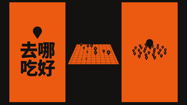

# make-demo-video

繁體中文 | [English](/README.en.md)

Claude Code 的 skill＋mod：幾分鐘把素材做成 demo 影片（MP4＋GIF）。

- **Skill**：`/make-demo-video` 讀素材、寫腳本、排分鏡，再用瀏覽器逐格算圖、ffmpeg 合成。
- **Mod**：對話旁邊的進度面板。在面板上選剪法、看每一幕的縮圖、調整分鏡，確認後按「合成影片」。


這支 showreel 是用這個 skill 自己的招牌片剪法做的，腳本、逐拍與畫面在 [examples/showreel/](examples/showreel/)，有配樂的版本是 [demo.mp4](examples/showreel/demo.mp4)。在 VS Code 面板裡操作的流程見 [examples/skill-flow/skill-flow.gif](examples/skill-flow/skill-flow.gif)。

### 怎麼運作

| 步驟 | 做什麼 | 產出 |
|---|---|---|
| ① 剪法 | Claude 讀完文字、文件或網址，推薦剪法並說明理由；在面板選剪法、比例、秒數、幕數，顏色一律從素材取 | `style.json` |
| ② 腳本 | 照選的剪法寫腳本（一句一幕） | `script.md` |
| ③ 分鏡 | 分鏡板上移、刪除、改字、重畫某一幕 | `storyboard.json` |
| ④ 合成 | 確認後算圖 | `demo.mp4`、`demo.gif`、結果頁 |

影片是分鏡表算出來的，不是錄螢幕：改一句字幕，大約 20 秒重算一次；不滿意某一幕，可以讓 Claude 只重新產生那一幕，或在面板重新選剪法。

### 三種剪法

剪法決定怎麼剪（腳本寫法、鏡頭順序、節奏），放在 `skills/make-demo-video/cuts/`，一包一個資料夾。① 會依素材推薦 1–3 包，第一個附上理由。

| | 快節奏導覽 `fast-tour` | 招牌片 `signature` | 操作示範 `walkthrough`（實驗中） |
|---|---|---|---|
| |  |  |  |
| 回答 | 這產品**有什麼** | 這產品**是誰** | 這產品**怎麼用** |
| 畫面 | 標語開場，手機在網站上捲到每句話的證據，作品卡快切；有數字或使用情境時加數字跳動、問句快切 | 一個概念貫穿到底，每個畫面由前一個變形而來，沒有硬切；配樂、動態模糊，首尾相接可循環 | 網頁鋪滿畫面，攝影機帶著游標走一遍：結果先上、找到、點下去、推近看細節、網址收尾；只在配樂重拍時硬切一次 |
| 適合 | 有網站可截圖的產品、作品集；放 README 的動圖 | 發表會、演講開場、社群上的品牌片 | 有操作流程的網站或工具（搜尋、切換、一鍵複製） |
| 素材 | 網站（手機版整頁長圖） | 產品名、標語、使用者會問的問題；截圖可有可無 | 網站（桌機版，操作路徑每一步一張截圖） |
| 預設 | 16:9、15 秒、一拍 0.4 秒 | 9:16、15 秒、一拍 0.5 秒 | 只做 16:9、22 秒、一拍 0.5 秒 |
| 做法 | 組合固定的鏡頭模板 | 生成式：先在面板選概念，Claude 每次從零寫 `reel.html` | 組合固定的鏡頭模板 |

快節奏導覽與操作示範只組合固定的鏡頭模板，同一份分鏡表永遠算出同一支片。

操作示範還在實驗中，功能先凍結：只做 16:9，面板不會給 9:16；鏡頭固定 8 段，面板不能直接增刪腳本句子，要多示範一步（最多 5 步）就在 `script.md` 加一行，再在對話裡請 Claude 照腳本重排。

招牌片每次的概念與畫面都不同，從讀素材到出片約 10 分鐘、十幾萬 token；定稿後改字、重出都從同一份 `reel.html` 改，逐拍修改每次 1–3 分鐘。

### 安裝

```bash
claude plugin marketplace add muchuanhung/make-demo-video
claude plugin install make-demo-video@make-demo-video --scope user
```

安裝後新開的 session 才會載入。需要 Node 18 以上與 Google Chrome；ffmpeg 已附在套件裡。

### 使用

```text
/make-demo-video 把這個 repo 做成 README 用的 demo 影片
/make-demo-video https://example.com 做一支 20 秒的直式介紹影片
```

面板在 VS Code 的 Claude 聊天面板，以及支援 kitty graphics 的終端機（Ghostty、kitty）顯示縮圖；沒有面板的環境（例如 `claude -p`）會改用對話框問同樣的問題。

### 實測過

只在 macOS 上實測過，不保證其他平台或之後的 Claude Code 版本。

- VS Code 的 Claude 聊天面板（Claude Code 2.1.331）：從網址做一支 9:16、9 幕的影片，① 到 ④ 全程用面板操作。
- `claude -p`：選項、重畫一幕、插入一幕都照預期產出。
- 素材：weather-board、發發菜單、Kinutabi、Syntax Atlas；16:9 與 9:16 都算過。
- 沒測過：終端機裡的面板畫面、Linux、Windows。

### 檢查

```bash
claude plugin validate .
claude plugin test .
node skills/make-demo-video/scripts/thumbs.mjs --check
```

### 授權

MIT，見 [LICENSE](/LICENSE)。
