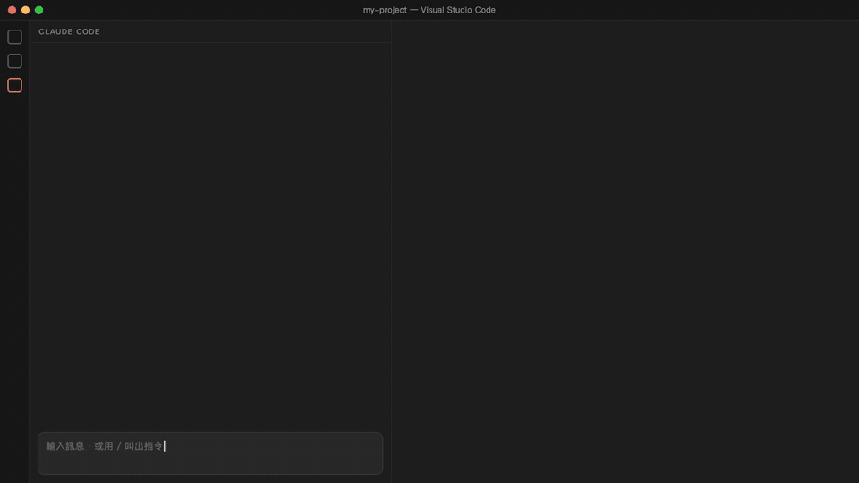

# make-demo-video

English | [繁體中文](/README.zh-TW.md)

A Claude Code skill and mod that turns a repo, a URL, a PDF or a piece of text into a demo video (MP4 + GIF, ready for a README) in a few minutes:

- **Skill**: `/make-demo-video` reads the material, writes a script, lays out a storyboard, then renders it frame by frame in a browser and joins the frames with ffmpeg.
- **Mod**: a progress pane next to the chat. Pick a style, see a thumbnail of every scene, adjust the storyboard, and press 合成影片 (Render) when it looks right.



The demo is an HTML reconstruction, not a screen recording: the waits are shortened (a real run takes about a minute to write the script and about 20 seconds to render), and the chat panel is drawn simpler than the real one. The scene thumbnails and the video on the result page were really rendered by this tool. Source in [`examples/skill-flow/`](examples/skill-flow/).

### How it works

| Step | What happens | Output |
|---|---|---|
| ① Script | Claude reads the material and writes one line per scene | `script.md` |
| ② Style | Pick a built-in style, aspect, length and scene count in the pane, or take colours from the material | `style.json` (custom only) |
| ③ Storyboard | Move, delete, reword or redo single scenes on the board | `storyboard.json` |
| ④ Render | Render once you confirm | `demo.mp4`, `demo.gif`, result page |

The video is computed from storyboard + style, not recorded: change a caption or swap the style and it re-renders in about 20 seconds; the storyboard is plain text you can commit and review.

### Install

```bash
claude plugin marketplace add muchuanhung/make-demo-video
claude plugin install make-demo-video@make-demo-video --scope user
```

Sessions started after the install load it. Needs Node 18 or later and Google Chrome; ffmpeg ships with the package.

### Use

```text
/make-demo-video turn this repo into a demo video for the README
/make-demo-video https://example.com make a 20-second vertical intro video
```

The pane shows thumbnails in the VS Code Claude chat panel and in terminals with kitty graphics (Ghostty, kitty). Where there is no pane (for example `claude -p`), the same questions are asked in a dialog.

The pane's UI is in Traditional Chinese only.

### Tested

On macOS only; no promise for other platforms or later Claude Code versions.

- VS Code Claude chat panel (Claude Code 2.1.331): a 9:16, 9-scene video from a URL, steps ① to ④ all driven from the pane.
- `claude -p`: options, redoing one scene and inserting one scene produced the expected results.
- Material: weather-board, 發發菜單, Kinutabi, Syntax Atlas, muchuan-portfolio; both 16:9 and 9:16.
- Not tested: the pane in a terminal, Linux, Windows.

### Checks

```bash
claude plugin validate .
claude plugin test .
node skills/make-demo-video/scripts/thumbs.mjs --check
```

### License

MIT, see [LICENSE](/LICENSE).
